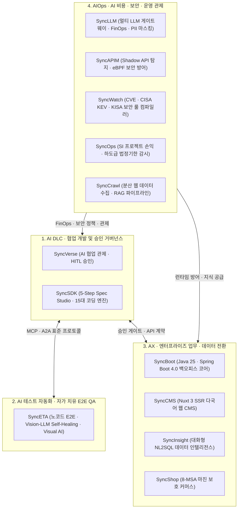

# 주식회사 엠파시 (Empasy Inc.)

**엔터프라이즈 AI 테스트 자동화 · AI DLC · AX · AIOps 통합 플랫폼 `SyncSeries`**

 

주식회사 엠파시(**Empasy Inc.**)는 기업의 **AX(AI Transformation)**, **AI DLC(AI-Driven Development Lifecycle)**, **AI 테스트 자동화(Self-Healing E2E QA)**, **AIOps · 보안 거버넌스**를 하나의 표준 아키텍처로 통합하는 엔터프라이즈 AI 소프트웨어 기업입니다.  
반복적인 개발·품질 검증·운영 업무는 AI 에이전트가 자율 수행하고, 중요한 변경과 배포는 **Human-in-the-Loop(HITL) 승인 거버넌스**로 안전하게 통제합니다.

---

## 4대 엔터프라이즈 AI 핵심 영역 (SyncSeries)

---

## 주력 솔루션: SyncETA (싱크에타) — 국산 AI 테스트 자동화 플랫폼

**[SyncETA](https://empasy.io/ko/solutions/sync-eta.html)**는 기존 스크립트 자동화(Selenium·단독 Playwright)의 높은 유지보수 비용과 매 스텝 LLM을 호출하는 클라우드 SaaS의 속도·비용·보안 한계를 동시에 해결하는 **하이브리드 AI 테스트 자동화 플랫폼**입니다.

- **노코드 멀티 입력**: 브라우저 클릭 동작 녹화, 기존 **엑셀·CSV 테스트케이스 업로드**, 한 줄 자연어 지시로 비개발자 QA·기획자·운영자도 즉시 E2E 시나리오 생성
- **반복 실행 LLM 비용 0원 + 실패 시점 자가 치유(Self-Healing)**: 일상적인 회귀 테스트는 결정론적 Playwright 엔진으로 고속 재생하고, UI 개편으로 셀렉터가 깨졌을 때만 **Vision-LLM + DOM 문맥**으로 실시간 자동 복구
- **시각적 회귀 검증(Visual Regression) & 링크 전수 검사**: 시나리오 없이도 사이트 전체 하위 링크 404·의미 불일치·글자 겹침·화면 깨짐을 전수 검사하며, 애매한 화면은 사진과 함께 `[확인 필요]`로 정직하게 분류
- **국내 실무 환경 특화 & 버그 칸반**: 한국형 금융 보안 가상 키패드 자동 인식, 글로벌 쿠키 동의 팝업 자동 닫기, 민감 개인정보 마스킹, 사진·영상 첨부 버그 칸반 보드 및 `[지금 확인]` 원클릭 재검증
- **온프레미스 · 사내 폐쇄망 완벽 지원**: Windows·macOS 데스크톱 앱([v0.0.66 무료 다운로드](https://empasy.io/ko/download_eta.html)) 로컬 구동 및 사내 서버·로컬 LLM(vLLM, Ollama)·CI/CD(Jira, Jenkins, GitHub Actions, Slack, Playwright MCP) 연동
- **핵심 원천 특허**: 대한민국 등록 특허 제10-2025-0125736호 (*웹 브라우저 동작 레코딩 기반 AI 자연어 테스트케이스 자동화*) — [특허 기술 문서](https://doc.empasy.com/patents/registered-web-action-recording)

### 2026 AI 테스트 자동화 패러다임 비교

> 상세 비교 분석: [AI 테스트 자동화 도구 비교 가이드 (2026) — empasy.io](https://empasy.io/ko/blog/ai-test-automation-tools-comparison-2026.html)

| 비교 항목 | 코드 프레임워크 (Selenium · Playwright) | AI 코딩 에이전트 (Cursor · Claude Code + Playwright MCP) | 순수 LLM · 해외 클라우드 SaaS | 하이브리드 AI E2E 플랫폼 (**엠파시 SyncETA**) |
| :--- | :--- | :--- | :--- | :--- |
| **주요 사용자** | 개발자 · SDET | 개발자 | QA · 기획자 | **QA · 기획자 · 운영자 · 개발자 공용** |
| **시나리오 작성** | 코드 수동 작성 | 프롬프트로 코드 초안 생성 | 자연어 · 클라우드 녹화 | **브라우저 클릭 녹화 · 엑셀 업로드 · 한 줄 문장 변환** |
| **UI 변경 대응 (Self-Healing)** | 수동 코드 수정 | 재프롬프트 및 코드 PR 필요 | 매 스텝 AI 재탐색 | **실패 시점 Vision-LLM + DOM 문맥 자가 치유** |
| **반복 실행 속도 · LLM 비용** | 매우 빠름 · 토큰 0원 | 빠름 · 수정 시 토큰 발생 | 느림 · 매 실행마다 토큰 과금 | **매우 빠름 · 반복 회귀 재생 LLM 비용 0원** |
| **시각 결함 · 링크 전수 검사** | 별도 구현 필요 | 코드 검증 중심 | 도구별 부분 지원 | **시나리오 없는 404 · 글자 겹침 · `[확인 필요]` 기본 내장** |
| **한국형 실무 장애물 대응** | 커스텀 코딩 | 매번 프롬프트 대응 | 한국형 보안 키패드 미지원 | **보안 가상 키패드 · 쿠키 배너 자동 통과 · PII 마스킹** |
| **사내 폐쇄망 · 국내 기술 지원** | 자체 구축 필요 | 클라우드 API 제약 | 클라우드 종속 · 국내 지원 제한 | **데스크톱 로컬 · 온프레미스 · 로컬 LLM · 국내 직접 지원** |

---

## SyncSeries 전체 11종 제품 디렉토리

| 영역 | 솔루션 | 핵심 역할 및 기능 | 공식 페이지 | 기술 문서 |
| :--- | :--- | :--- | :--- | :--- |
| **AI 테스트 자동화** | **SyncETA** *(주력)* | Vision-LLM 셀렉터 자가 치유, 노코드 웹·모바일 E2E QA, 시각적 회귀 검증, 버그 칸반 | [제품 소개](https://empasy.io/ko/solutions/sync-eta.html) · [독립 사이트](https://eta.empasy.io/) | [SyncETA Docs](https://doc.empasy.com/synceta/) |
| **AI DLC** | **SyncVerse** *(주력)* | 멀티 에이전트 협업 관제, 5-Step Spec Studio, HITL 단계별 배포 승인 거버넌스 | [제품 소개](https://empasy.io/ko/solutions/sync-verse.html) | [SyncVerse Docs](https://doc.empasy.com/syncverse/) |
| **AX 코어** | **SyncBoot** *(주력)* | Java 25 · Spring Boot 4.0 엔터프라이즈 백오피스 코어(SSO, 조직·권한 RBAC, 전자결재) | [제품 소개](https://empasy.io/ko/solutions/sync-boot.html) | [SyncBoot Docs](https://doc.empasy.com/syncboot/) |
| **AX 웹** | **SyncCMS** *(주력)* | Nuxt 3 SSR 하이브리드 다국어(KO/EN/JA) 기업 웹사이트 통합 관리 · 배포 승인 | [제품 소개](https://empasy.io/ko/solutions/sync-cms.html) | [SyncCMS Docs](https://doc.empasy.com/synccms/) |
| **AX 데이터** | **SyncInsight** | 자연어 데이터 조회(NL2SQL), 딥 리서치 리포트, 데이터 리니지 (SyncVerse 통합) | [제품 소개](https://empasy.io/ko/solutions/sync-insight.html) | [SyncInsight Docs](https://doc.empasy.com/syncinsight/) |
| **AIOps · FinOps** | **SyncLLM** | 멀티 LLM 게이트웨이, 부서별 토큰 예산 통제, `pgvector` 시맨틱 캐싱, PII 마스킹 | [제품 소개](https://empasy.io/ko/solutions/sync-llm.html) | [SyncLLM Docs](https://doc.empasy.com/syncllm/) |
| **AIOps · 데이터** | **SyncCrawl** | 구조 변경 대응 분산 웹 데이터 수집 및 기업 RAG 지식 베이스 정제 파이프라인 | [제품 소개](https://empasy.io/ko/solutions/sync-crawl.html) | [SyncCrawl Docs](https://doc.empasy.com/synccrawl/) |
| **AIOps · API 보안** | **SyncAPIM** | 숨은(Shadow) API 자동 탐지, 계약 드리프트 검사, 무중단 가상 패치, eBPF 커널 방어 | [제품 소개](https://empasy.io/ko/solutions/sync-apim.html) | [SyncAPIM Docs](https://doc.empasy.com/syncapim/) |
| **AIOps · 위협 관제** | **SyncWatch** | NVD CVE · CISA KEV · OSV · KISA 취약점 수집 및 코드 감사·런타임 방어 룰 컴파일러 | [제품 소개](https://empasy.io/ko/solutions/sync-watch.html) | [SyncWatch Docs](https://doc.empasy.com/syncwatch/) |
| **AX 커머스** | **SyncShop** | 8-서비스 분산 마이크로서비스(MSA) 이커머스, 최소 마진 보호 및 스냅샷 즉시 복원 | [제품 소개](https://empasy.io/ko/solutions/sync-shop.html) | [SyncShop Docs](https://doc.empasy.com/syncshop/) |
| **AIOps · PMO** | **SyncOps** | SI 프로젝트 계약 vs 투입 원가 실시간 손익 추적, 하도급 법정기한 · 보증증권 감시 | [제품 소개](https://empasy.io/ko/solutions/sync-ops.html) | [SyncOps Docs](https://doc.empasy.com/syncops/) |

---

## 주요 엔터프라이즈 · 기관 레퍼런스

*(비밀 유지 계약에 따라 개별 프로젝트명은 비공개로 하고, 산업군별 지원 기업·기관 및 수행 영역만 표기합니다.)*

- **글로벌 · 에듀테크 테스트 자동화**: Samsung.com (글로벌 테스트 자동화), 비상교육(Visang Education, 테스트 자동화)
- **대기업 제조 · 엔터프라이즈 IT**: LG CNS, LG전자, LG화학, 현대자동차
- **모빌리티 · 정보보안 관제**: 아우토크립트(AUTOCRYPT), 펜타시큐리티(Penta Security)
- **공공 · 교육 데이터 플랫폼**: 펜타시스템 & 경기도교육청 (공공 교육 데이터 플랫폼 협업)

---

## 공통 엔터프라이즈 기술 스택

- **AI · Agent · Protocol**: AgentScope Java, Model Context Protocol (MCP), A2A Orchestration, Vision-LLM, Local LLM (vLLM, Ollama, TGI), Tri-Hybrid RAG
- **Backend & Data**: Java 25, Spring Boot 4.0, Spring Cloud 2025, PostgreSQL 18.6 (`pgvector`, `pg_trgm`), Redis 7, RabbitMQ, KEDA
- **Frontend & Desktop**: Vue 3, TypeScript, Vite, Vben Admin, Nuxt 3 SSR, Electron + Quasar (`SyncETA Desktop`)
- **QA & Security**: Playwright MCP, Appium 3.7+ Dual Mobile Engine, eBPF Runtime Defense, Kubernetes (EKS/AKS/On-Premise)

---

## English Executive Summary

**Empasy Inc. (주식회사 엠파시)** builds **SyncSeries**, an integrated enterprise platform unifying **AI Test Automation (`SyncETA`)**, **AI-Driven Development Lifecycle / AI DLC (`SyncVerse` & `SyncSDK`)**, **Enterprise AX (`SyncBoot`, `SyncCMS`, `SyncInsight`, `SyncShop`)**, and **AIOps & AI Security Governance (`SyncLLM`, `SyncAPIM`, `SyncWatch`, `SyncOps`, `SyncCrawl`)**.

- **Flagship AI Test Automation (`SyncETA` v0.0.66)**: Combines no-code browser action recording, Excel/CSV & one-line prompt conversion, **Vision-LLM + DOM context selector Self-Healing**, **Visual Regression** layout/link auditing, and **zero-LLM-cost deterministic Playwright replay**—deployable via local desktop apps (Windows/macOS) or air-gapped on-premise servers. Backed by **Korean Registered Patent No. 10-2025-0125736**.
- **Official Resources**: [empasy.io](https://empasy.io/en/pages/index.html) · [SyncETA](https://eta.empasy.io/en/) · [Developer Docs](https://doc.empasy.com/en/) · [Live Demo Portal](https://demo.empasy.io/en/) · [2026 AI Test Automation Tools Comparison](https://empasy.io/en/blog/ai-test-automation-tools-comparison-2026.html)

---

## 공식 채널 및 기업 정보

- **공식 홈페이지**: https://empasy.io (`llms.txt`: https://empasy.io/llms.txt)
- **SyncETA 제품 홈페이지**: https://eta.empasy.io/ | **무료 다운로드**: https://empasy.io/ko/download_eta.html
- **통합 라이브 데모 포털** *(회원가입 불필요)*: https://demo.empasy.io/
- **공식 기술 문서 포털**: https://doc.empasy.com/
- **기업 인증**: 주식회사 엠파시 (Empasy Inc.) | 대표이사 오병문 | 사업자등록번호 `547-81-03408` | 혁신성장유형 벤처기업 확인 (제 `20261111030084` 호)
- **도입 및 제휴 문의**: [poh@empasy.com](mailto:poh@empasy.com) | `+82-507-1360-8169`

Copyright © 2026 Empasy Inc. All rights reserved.

